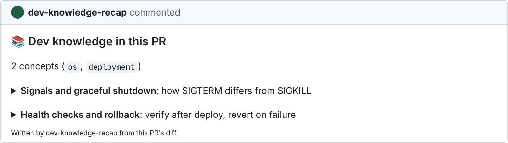
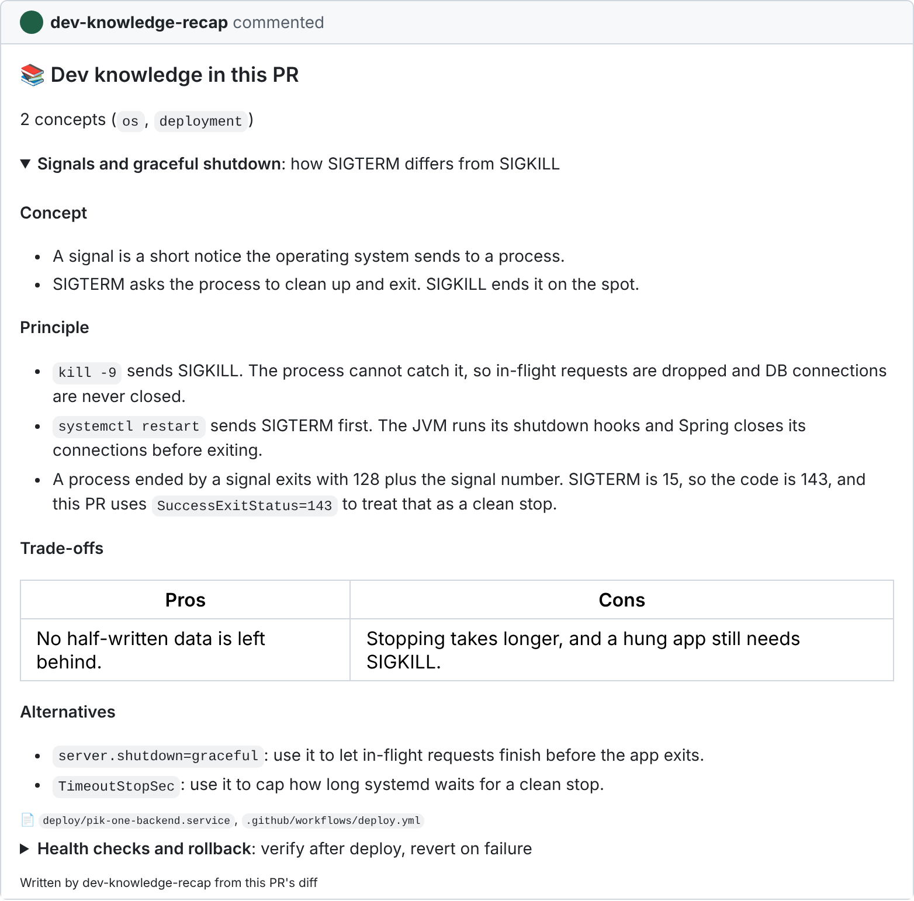

<div align="center">

# 📚 dev-knowledge-recap

**Learn the CS behind the code your AI just wrote.**

A Claude Code skill that reads your PR and writes short study notes on the concepts underneath it.


<br>
<br>



</div>

<br>

## Why

AI makes it easy to ship code you could not explain. You ask it to fix a deploy script, it swaps `kill -9` for a systemd service, adds a health check, and the PR looks fine. But do you know why SIGTERM matters, or what exit code 143 means?

dev-knowledge-recap picks out those concepts and writes them up, so every PR leaves you knowing a little more than before.

It is not a code reviewer, and it does not summarize your change. Your PR description already does that.

## What you get

Each concept opens into four parts.

| Section | What it covers |
|---|---|
| **Concept** | What it is, in a sentence or two |
| **Principle** | How it works, and how this PR's code uses it |
| **Trade-offs** | What you gain and what you give up |
| **Alternatives** | Other ways to do it, and when to pick them |

<details>
<summary><b>See an expanded comment</b></summary>
<br>



</details>

It goes one level below the API. `Promise.all` becomes a note on concurrency and the event loop. `@Transactional` becomes a note on isolation levels.

## Install

In Claude Code, add the marketplace and install the plugin:

```
/plugin marketplace add kimjungminn24/dev-knowledge-recap
/plugin install dev-knowledge-recap@dev-knowledge-recap
```

On recent versions of Claude Code this also works as one line:

```
/plugin install dev-knowledge-recap --marketplace kimjungminn24/dev-knowledge-recap
```

<details>
<summary>Install without the plugin system</summary>
<br>

Copy the skill folder into your project, or into `~/.claude/skills/` to use it everywhere. It then runs as `/recap`.

```bash
git clone https://github.com/kimjungminn24/dev-knowledge-recap
mkdir -p .claude/skills && cp -r dev-knowledge-recap/skills/recap .claude/skills/
```

</details>

## Usage

Run it on a branch with an open PR:

```
/dev-knowledge-recap:recap
```

It asks where to put the notes: a PR comment, Markdown files in `docs/`, or both. To skip the question, pass it:

```
/dev-knowledge-recap:recap --target docs --depth detailed
```

| Option | Values | Default |
|---|---|---|
| `--target` | `pr`, `docs`, `both` | asks |
| `--depth` | `concepts`, `summary`, `detailed` | `summary` |
| `--lang` | `auto`, `en`, `ko`, ... | follows the PR, else English |
| `--max` | 1 to 5 | 2 |
| `--dry-run` | | off |

To set defaults for a repo, add `.dev-knowledge-recap.yml`:

```yaml
target: docs
depth: summary
max: 2
```

## Building a knowledge base

With `--target docs`, each concept gets its own file:

```
docs/dev-knowledge/
├── README.md               index of every concept
├── graceful-shutdown.md
└── health-check-rollback.md
```

When a concept comes up again in a later PR, the existing file gets that PR added to it instead of a new copy. Over time the folder turns into a CS notebook built from your own code.

## Light on tokens

The diff is the expensive part, so the skill reads as little of it as it can.

- It stops early when nothing new has been pushed since the last run, or when only docs, assets or tests changed.
- It picks at most five relevant files from the diff stat and reads only those.
- The analysis runs in a subagent, so the diff never fills up your main conversation.

## Design

The full design, including how concepts are chosen and the writing rules, is in [docs/DESIGN.md](docs/DESIGN.md).
